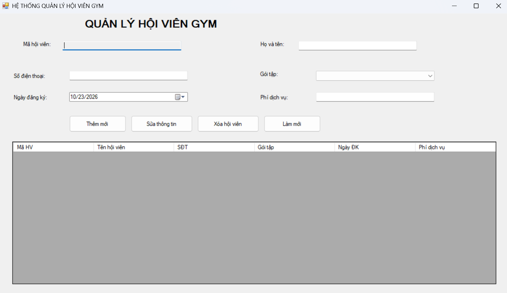
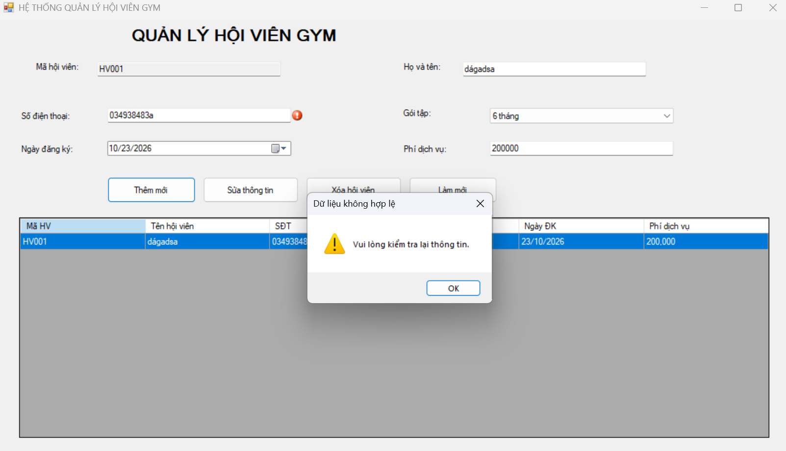
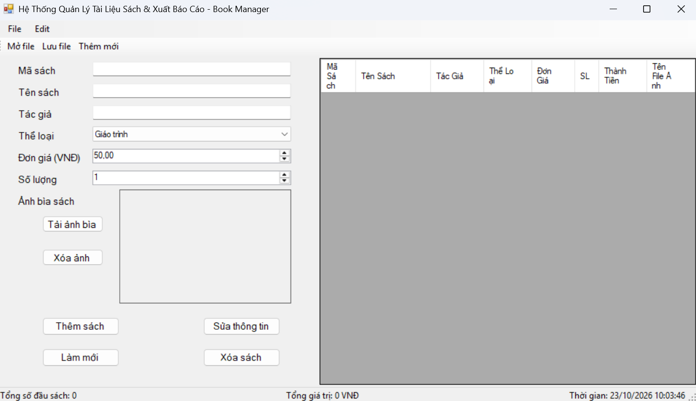
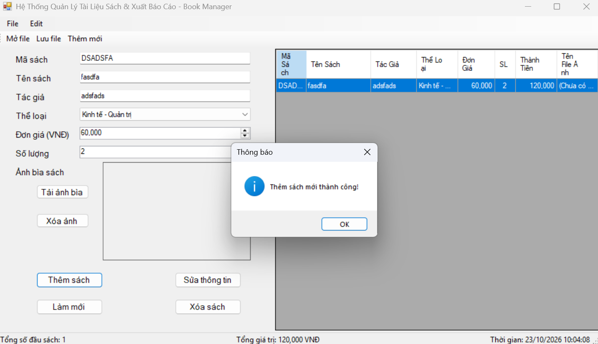
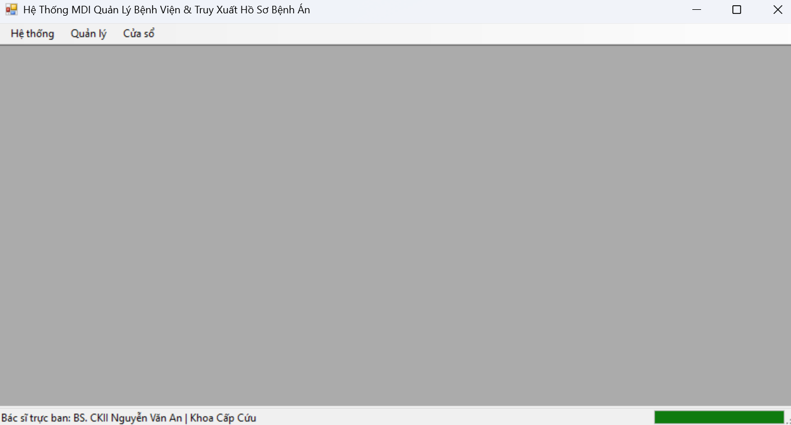
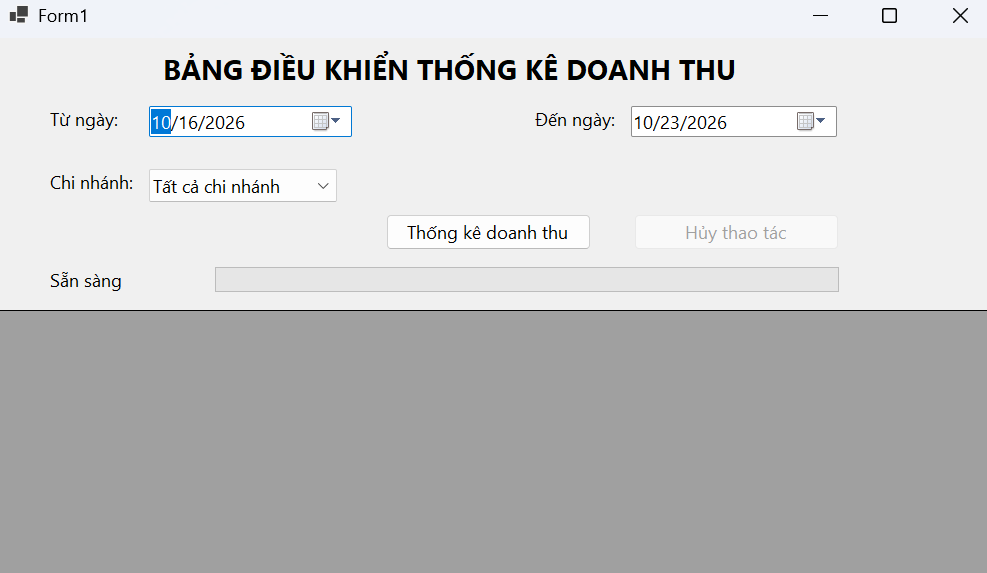
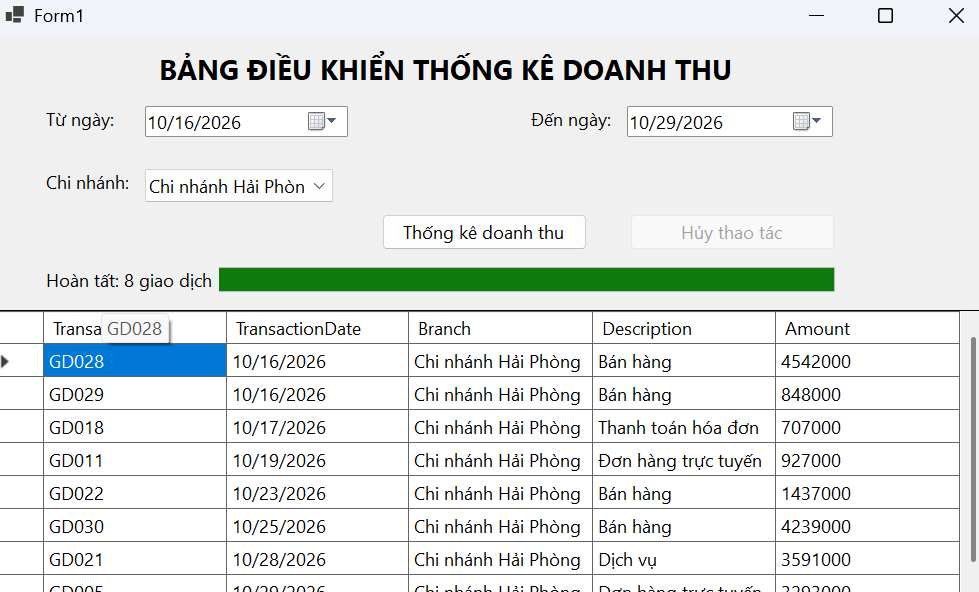
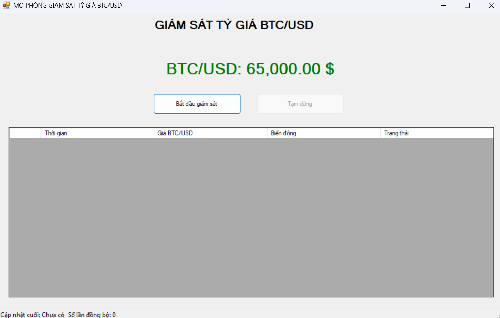
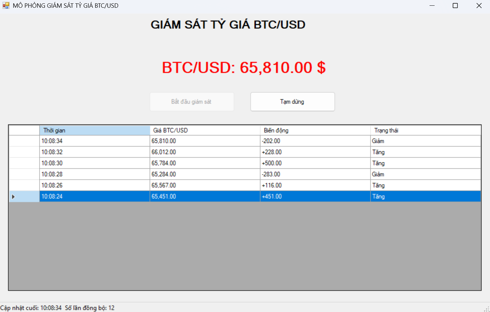

# BÁO CÁO BÀI TẬP THỰC HÀNH LẬP TRÌNH C# WINFORMS

## I. THÔNG TIN SINH VIÊN

- **Họ và tên:** Nguyễn Văn An
- **Mã số sinh viên:** 24810320020
- **Lớp học phần:** D19QTANM1
- **Môn học:** Laptrinh.net
- **Link Repository:** https://github.com/NguyenAn0602/LTNET-TEST02_24810320020_NguyenVanAn.git

---

## II. DANH SÁCH BÀI TẬP HOÀN THÀNH & TỰ ĐÁNH GIÁ

| Bài tập | Tiêu đề bài tập | Trạng thái | Mức độ hoàn thành (%) |
|:---:|---|:---:|:---:|
| **Bài 1** | Hệ thống Quản lý Dịch vụ Phòng Gym & Hội viên | [Chưa thực hiện/Đang thực hiện/Hoàn thành] | 100% |
| **Bài 2** | Quản lý Tài liệu Sách & Xuất Báo cáo Nhà sách | [Chưa thực hiện/Đang thực hiện/Hoàn thành] | 100% |
| **Bài 3** | Hệ thống MDI Quản lý Bệnh viện & Truy xuất Hồ sơ Bệnh án | [Chưa thực hiện/Đang thực hiện/Hoàn thành] | 100% |
| **Bài 4** | Bảng Điều khiển Thống kê Doanh thu Multi-threading | [Chưa thực hiện/Đang thực hiện/Hoàn thành] | 100% |
| **Bài 5** | Mô phỏng Giám sát Tỷ giá Tài chính Thời gian thực | [Chưa thực hiện/Đang thực hiện/Hoàn thành] | 100% |

> **Lưu ý:** Cập nhật trạng thái và phần trăm theo đúng chức năng đã hoàn thành, kiểm thử thực tế và hình ảnh minh chứng của bạn.

---

## III. MINH HỌA GIAO DIỆN & KỸ THUẬT NỔI BẬT

### 1. Bài 1: Hệ thống Quản lý Dịch vụ Phòng Gym & Hội viên

**Kỹ thuật áp dụng**
- Khai báo và cấu hình các cột `DataGridView` hoàn toàn bằng code với `AutoGenerateColumns = false`.
- Sử dụng `BindingList<MemberModel>` và `BindingSource` để quản lý, đồng bộ dữ liệu với lưới.
- Ràng buộc dữ liệu giữa các control nhập liệu và đối tượng hội viên.
- Kiểm tra dữ liệu họ tên, số điện thoại và phí dịch vụ bằng `ErrorProvider`.
- Hỗ trợ thêm mới, sửa thông tin, xóa hội viên và làm mới biểu mẫu.
- Khi chọn một dòng trên `dgvMembers`, thông tin hội viên được hiển thị lên các control tương ứng.
- Hiển thị hộp thoại xác nhận trước khi xóa hội viên.

**Hình ảnh minh họa**

*Mô tả: Giao diện quản lý hội viên, khu vực nhập thông tin và danh sách hội viên.*

*Mô tả: Minh họa thông báo lỗi khi dữ liệu nhập không hợp lệ.*

---

### 2. Bài 2: Quản lý Tài liệu Sách & Xuất Báo cáo Nhà sách

**Kỹ thuật áp dụng**
- Xây dựng giao diện với `MenuStrip`, `ToolStrip` và `StatusStrip`.
- Sử dụng `OpenFileDialog` để chọn ảnh bìa sách và mở file CSV.
- Hiển thị ảnh bìa bằng `PictureBox`, lưu đường dẫn hoặc tên file ảnh trong đối tượng sách.
- Sử dụng `SaveFileDialog` để chọn vị trí xuất báo cáo CSV.
- Đọc file CSV, chuyển dữ liệu thành các đối tượng `BookModel` và nạp vào `BindingList<BookModel>`.
- Cập nhật tổng số đầu sách, tổng giá trị sách trong kho và thời gian hiện tại trên `StatusStrip`.
- Hỗ trợ thêm, xóa và tìm kiếm sách theo chức năng đã triển khai.

**Hình ảnh minh họa**

*Mô tả: Giao diện danh sách sách và khu vực hiển thị ảnh bìa.*

*Mô tả: Minh họa thao tác mở hoặc lưu dữ liệu sách bằng file CSV.*

---

### 3. Bài 3: Hệ thống MDI Quản lý Bệnh viện & Truy xuất Hồ sơ Bệnh án

**Kỹ thuật áp dụng**
- Xây dựng Form cha với thuộc tính `IsMdiContainer = true`.
- Tạo các Form con phục vụ quản lý hồ sơ bệnh nhân, lịch trực bác sĩ và các danh mục liên quan theo phạm vi triển khai.
- Gán `MdiParent` cho Form con trước khi gọi `Show()`.
- Duyệt `MdiChildren` để kiểm tra Form đã mở; nếu đã tồn tại thì gọi `Activate()` thay vì mở bản sao.
- Hỗ trợ sắp xếp cửa sổ dạng Cascade, Tile Horizontal và Tile Vertical.
- Quản lý đóng các Form con và hiển thị trạng thái trên `StatusStrip`.

**Hình ảnh minh họa**

*Mô tả: Giao diện Form cha MDI và các cửa sổ con.*

---

### 4. Bài 4: Bảng Điều khiển Thống kê Doanh thu Multi-threading

**Kỹ thuật áp dụng**
- Sử dụng `async` và `await` để xử lý tác vụ bất đồng bộ.
- Sử dụng `Task.Run(...)` để đưa công việc tổng hợp dữ liệu mô phỏng sang Background Thread.
- Giữ cho UI Thread phản hồi trong thời gian xử lý dữ liệu.
- Dùng `CancellationTokenSource` và `CancellationToken` để hỗ trợ hủy tác vụ an toàn.
- Cập nhật `ProgressBar`, `Label` trạng thái và `DataGridView` trên UI Thread.
- Hiển thị dữ liệu thống kê theo khoảng ngày và chi nhánh theo chức năng đã triển khai.

**Hình ảnh minh họa**

*Mô tả: Giao diện chọn tiêu chí thống kê và hiển thị kết quả doanh thu.*

*Mô tả: Minh họa trạng thái xử lý, tiến độ và thao tác hủy tác vụ.*

---

### 5. Bài 5: Mô phỏng Giám sát Tỷ giá Tài chính Thời gian thực

**Kỹ thuật áp dụng**
- Sử dụng `Task.Run(...)` để chạy vòng lặp giám sát ở Background Thread.
- Sinh giá BTC/USD mô phỏng theo chu kỳ 2 giây.
- Dùng `CancellationTokenSource` để gửi yêu cầu dừng vòng lặp khi người dùng tạm dừng giám sát.
- Kiểm tra `InvokeRequired` và sử dụng `Invoke(...)` để chuyển thao tác cập nhật giao diện về UI Thread.
- Hiển thị giá BTC/USD trên `lblBTCPrice`, đổi màu xanh khi giá tăng và đỏ khi giá giảm.
- Cập nhật thời gian quét cuối, số lượt đồng bộ thành công trên `StatusStrip`.
- Ghi lại lịch sử giá vào `dgvHistoryLog` và giới hạn số dòng lịch sử nếu cần.

**Lưu ý:** Giá BTC/USD trong bài tập là dữ liệu mô phỏng ngẫu nhiên, không phải dữ liệu thị trường trực tiếp từ sàn giao dịch.

**Hình ảnh minh họa**

*Mô tả: Giao diện hiển thị giá BTC/USD, trạng thái đồng bộ và lịch sử biến động giá.*

*Mô tả: Nhật ký các lần quét giá, thời gian cập nhật và trạng thái tăng/giảm.*